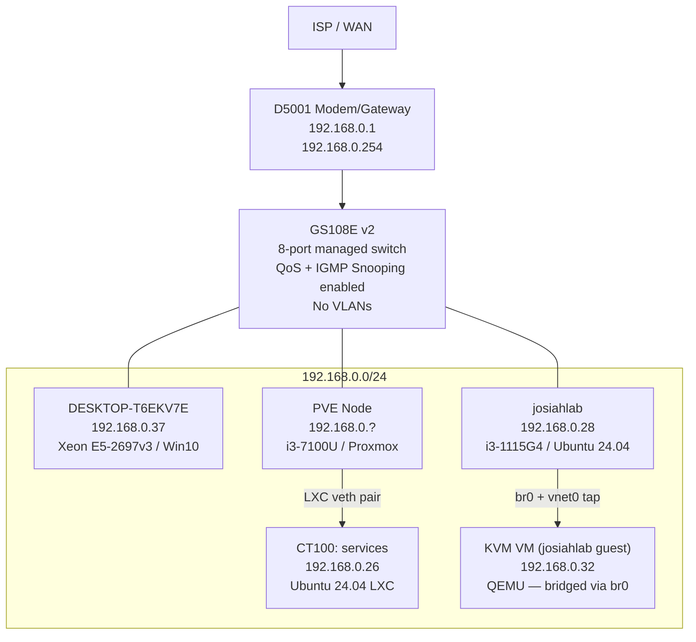
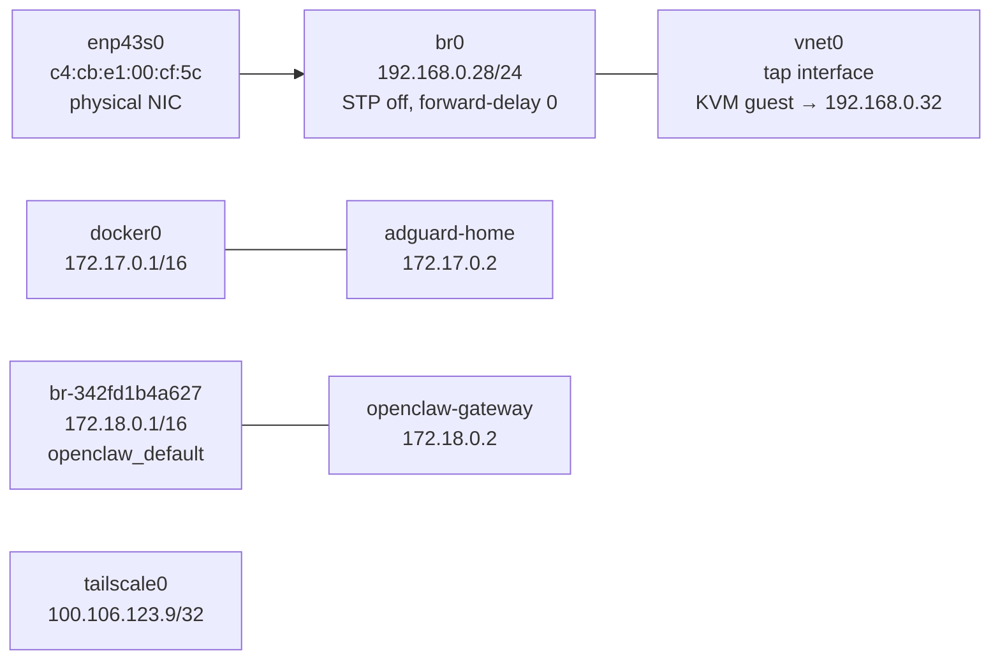
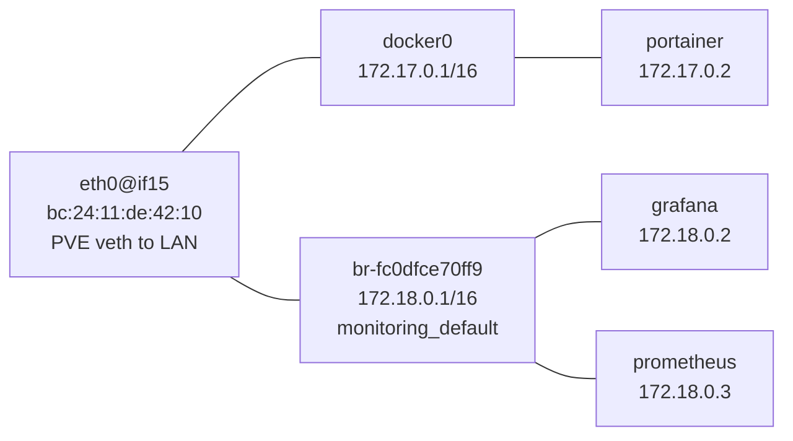
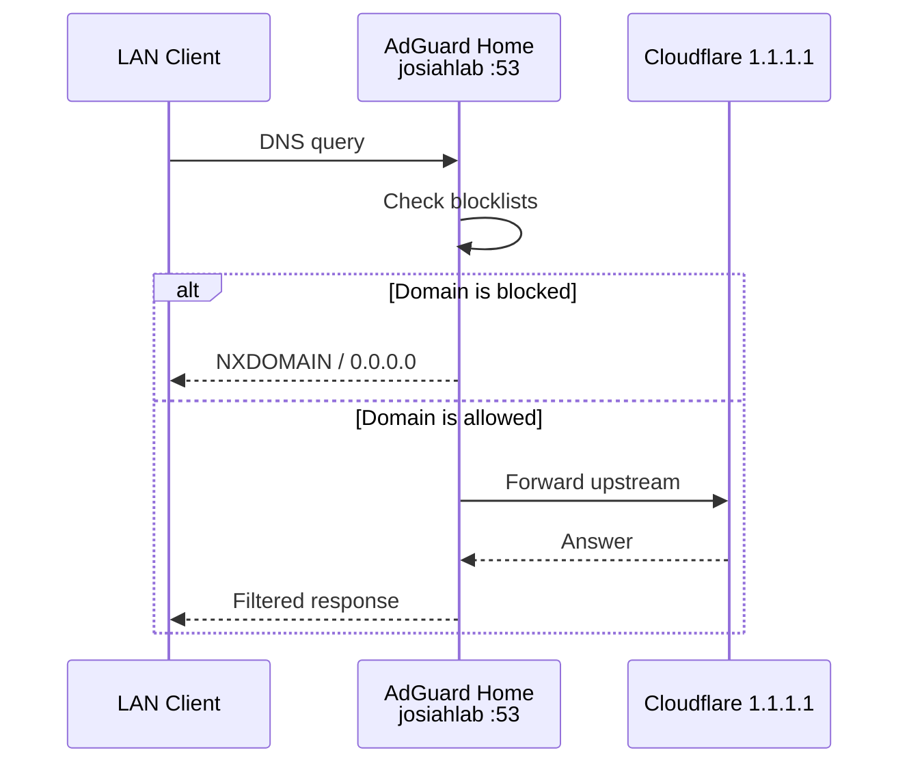
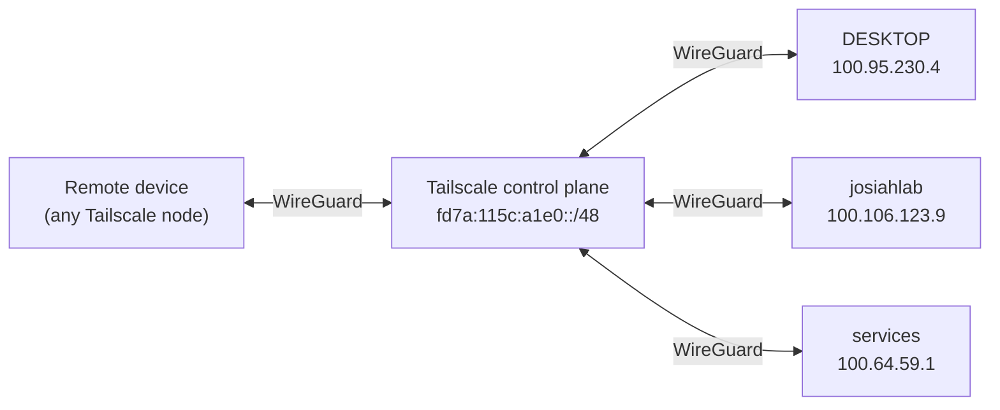

# Network Topology

**Subnet:** 192.168.0.0/24
**Gateway:** 192.168.0.1 — D5001 modem/gateway (ISP-provided combo unit)
**Secondary modem IP:** 192.168.0.254 — same physical D5001 device

---

## Physical Layout

The network is simpler than most homelabs of equivalent complexity. There is no dedicated router. The ISP line goes into the D5001, which is a modem and NAT gateway in one box. A Netgear GS108E v2 switch connects directly to the D5001's LAN port, and everything else plugs into the switch. The D5001 runs DHCP for the 192.168.0.0/24 subnet and is the default gateway for all hosts.

The D5001 shows up at two IPs — 192.168.0.1 and 192.168.0.254 — with consecutive MACs (34:7a:60:22:77:62 and 34:7a:60:22:77:63), which strongly suggests they are two interfaces or management addresses on the same physical device. The .1 address is the active default gateway; the .254 address is likely the modem's management UI or a secondary interface.

---

## Layer 2 — josiahlab

josiahlab uses a Linux bridge to give KVM guests direct LAN presence. The physical NIC (enp43s0) is enslaved to br0, which holds the 192.168.0.28/24 address. The KVM guest attaches via vnet0 (a tap interface) to br0, which is why it appears on the LAN at 192.168.0.32 rather than behind a NAT.

Docker bridges sit separately from this. docker0 (172.17.0.0/16) and br-342fd1b4a627 (172.18.0.0/16) are both NATted — containers reach the internet through josiahlab's IP, and port-forwarding rules created by Docker make specific container ports accessible from outside.

---

## Layer 2 — CT100

CT100 connects to the LAN via a veth pair managed by Proxmox. From inside the container, eth0 is one end of that pair, and the other end sits on the Proxmox host's bridge connected to the physical LAN. Docker inside CT100 then creates its own bridge networks for containers running there.

---

## Docker Port Forwarding

### josiahlab

When a port is published in Docker, Docker creates a DNAT rule in iptables that redirects traffic arriving at the host's port to the container's internal IP and port. This happens automatically when containers are started.

| Host Port | Container | Function |
|---|---|---|
| :53 TCP/UDP | 172.17.0.2:53 | AdGuard Home DNS |
| :853 TCP | 172.17.0.2:853 | AdGuard DNS-over-TLS |
| :784 UDP | 172.17.0.2:784 | AdGuard DNS-over-QUIC |
| :3001 TCP | 172.17.0.2:80 | AdGuard web UI |
| :18789 TCP | 172.18.0.2:18789 | OpenClaw Gateway |
| :18790 TCP | 172.18.0.2:18790 | OpenClaw Gateway |

### CT100

| Host Port | Container | Function |
|---|---|---|
| :9000 TCP | 172.17.0.2:9000 | Portainer HTTP |
| :9443 TCP | 172.17.0.2:9443 | Portainer HTTPS |
| :3000 TCP | 172.18.0.2:3000 | Grafana |
| :9090 TCP | 172.18.0.3:9090 | Prometheus |

---

## DNS Flow

AdGuard Home running on josiahlab serves as the DNS resolver for the network. Clients configured to use 192.168.0.28 as their DNS server have their queries intercepted and filtered by AdGuard before being forwarded upstream to Cloudflare (1.1.1.1). Blocked domains get NXDOMAIN or a zero-IP response; allowed domains get the real answer.

The D5001's DHCP server is the distribution point. To push AdGuard Home as the DNS for all LAN clients, the DHCP DNS option on the D5001 needs to point to 192.168.0.28. Whether this is currently configured is worth confirming.

CT100 is a special case — its `/etc/resolv.conf` is managed by Tailscale's MagicDNS and points to `100.100.100.100` rather than AdGuard. This means CT100 resolves DNS through Tailscale, not through the local AdGuard instance. This is fine operationally but means CT100's DNS queries are not filtered or logged by AdGuard.

---

## Tailscale Overlay

On top of the physical LAN, a Tailscale mesh connects all three lab nodes and an unknown number of other registered devices (phones, laptops, remote machines). Each node gets a stable IP in the 100.64.0.0/10 range. WireGuard handles the encryption and tunnelling.

---

## Known LAN Devices

| IP | MAC | Identified As |
|---|---|---|
| 192.168.0.1 | 34:7a:60:22:77:62 | D5001 gateway (primary) |
| 192.168.0.254 | 34:7a:60:22:77:63 | D5001 gateway (secondary) |
| 192.168.0.26 | bc:24:11:de:42:10 | CT100 (services) |
| 192.168.0.28 | c2:48:bb:f3:8a:53 | josiahlab br0 |
| 192.168.0.32 | 52:54:00:10:b4:6e | KVM VM on josiahlab |
| 192.168.0.37 | 00:e0:4c:cd:06:d7 | DESKTOP-T6EKV7E |
| 192.168.0.39 | bc:f1:71:ec:f4:14 | Unknown — likely Proxmox CT/VM |
| 192.168.0.51 | 4c:cc:6a:d6:38:d2 | Unknown |
| 192.168.0.53 | bc:24:11:b5:ba:00 | Unknown — Proxmox OUI |
| 192.168.0.54 | bc:24:11:6d:83:c7 | Unknown — Proxmox OUI |
| 192.168.0.33 | ce:11:0d:8c:bf:60 | Unknown |
| 192.168.0.34 | 46:7c:d4:e2:4f:b4 | Unknown |
| 192.168.0.36 | 2a:64:25:08:61:6e | Unknown |
| 192.168.0.38 | e0:01:c7:6c:3f:fd | Unknown |
| 192.168.0.40 | 96:95:ed:ce:3d:9d | Unknown |

The number of unidentified devices is worth addressing. Running a proper network scan and building a complete device inventory would give a much clearer picture of what is on the LAN and whether any of those unknowns are unexpected.

---

## Future Network Plans

The flat 192.168.0.0/24 network is the most significant architectural debt in the current setup. Every machine can reach every other machine on every port without restriction. The path to a better architecture is:

1. Introduce an edge firewall appliance (pfSense or OPNsense on a small x86 box) between the D5001 and the GS108E
2. Configure VLANs on the GS108E to segment: management traffic, storage traffic (iSCSI), general lab machines, potentially a guest/IoT segment
3. Define inter-VLAN firewall rules at the edge appliance — storage VLAN can only be reached by designated initiator IPs, management VLAN is locked to specific source IPs, etc.
4. Move DNS enforcement to the edge appliance rather than relying on per-device configuration

None of this is urgent from an availability standpoint, but it is the right direction for a lab that is being used to run real services and store meaningful data.
