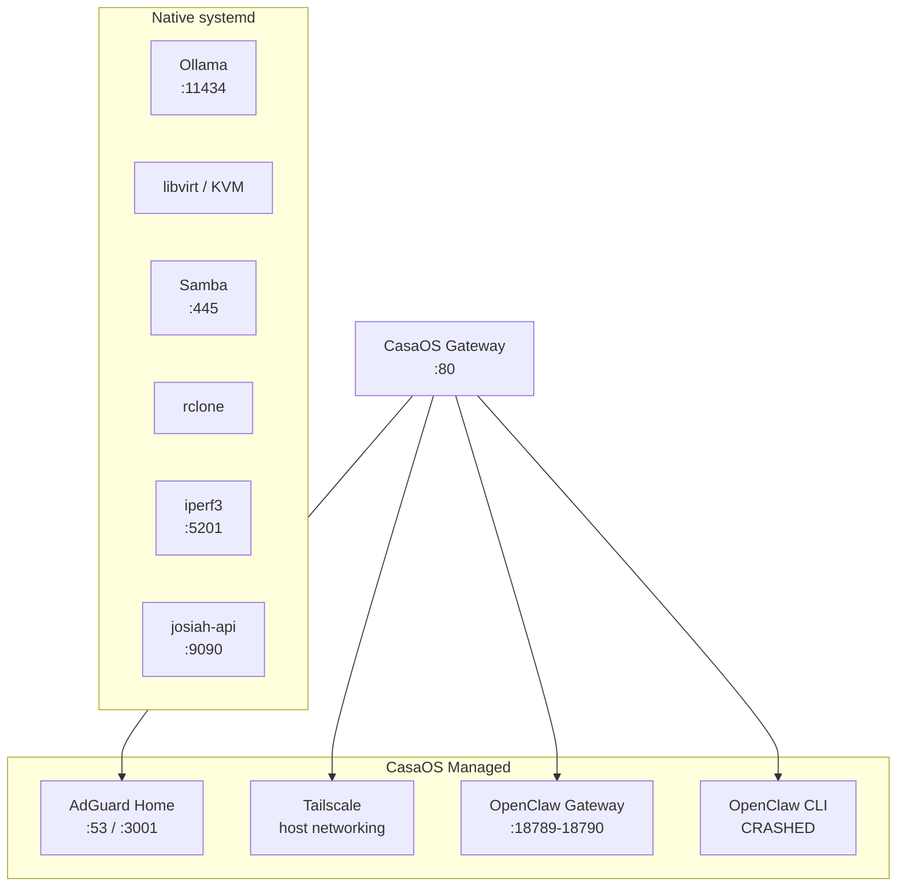

# josiahlab — Services

**Host:** josiahlab — 192.168.0.28 — Ubuntu 24.04.4 LTS
**Docker:** 29.3.0 | Compose: v5.1.0 | containerd: v2.2.1 | runc: 1.3.4
**Containers at audit:** 4 total — 3 running, 1 exited

---

## Architecture Overview

josiahlab runs a mix of containerised services under CasaOS and native systemd services. CasaOS acts as the app management layer on top of Docker — it provides a web UI for deploying and managing containers, handles compose files, and manages app data storage under `/DATA/AppData/`. The native systemd services (Ollama, libvirtd, Samba, rclone, iperf3) run outside of CasaOS's management, directly on the host.

The separation between what CasaOS manages and what runs natively is partly intentional and partly historical. Ollama was not available in the CasaOS app store when it was first installed, so it went in as a systemd service. The KVM hypervisor naturally lives at the system level. CasaOS is used for services that benefit from its UI and app lifecycle management — primarily the Docker containers.



---

## AdGuard Home

AdGuard Home is the DNS resolver for the LAN. It is running as a Docker container, pinned to version `v0.107.61`, and has been up for 11 days continuously at the time of the audit.

### Why it runs in Docker

The decision to containerise AdGuard rather than install it natively came down to upgrade management. CasaOS makes it easy to update the container image, roll back if something breaks, and inspect logs. The alternative — a native binary installed via the shell script — is fine but less convenient to manage. Containers also provide clear isolation: if AdGuard misbehaves, it is constrained to its bridge network and cannot affect the host directly.

### Network configuration

AdGuard sits on docker0 (the default Docker bridge) at `172.17.0.2`. Docker's iptables DNAT rules forward four host-level ports into the container:

| Host port | Container port | Protocol | Purpose |
|---|---|---|---|
| :53 | :53 | TCP + UDP | Standard DNS |
| :853 | :853 | TCP | DNS-over-TLS |
| :784 | :784 | UDP | DNS-over-QUIC |
| :3001 | :80 | TCP | Web management UI |

DNS-over-TLS and DNS-over-QUIC are enabled, which means devices that support encrypted DNS (modern Android, iOS, and browsers) can use AdGuard as an encrypted resolver without needing a separate proxy. The web UI is remapped to port 3001 on the host because port 80 is taken by CasaOS's gateway.

### What it does

AdGuard intercepts all DNS queries, checks them against its block lists (for ads, trackers, malware domains, etc.), and forwards non-blocked queries upstream to Cloudflare's 1.1.1.1. The web UI at `http://192.168.0.28:3001` shows real-time query logs, block statistics, and allows adding custom rules.

The upstream DNS is configured as Cloudflare (1.1.1.1 and 1.0.0.1). An alternative worth considering is using DNS-over-HTTPS upstream rather than plain DNS, which would prevent the ISP from observing upstream DNS traffic even if they are inspecting traffic beyond the D5001.

### Container details

```
Container: adguard-home
Image: adguard/adguardhome:v0.107.61
Status: Up 11 days
IP: 172.17.0.2 (docker0)
Network: bridge (docker0)
```

---

## Tailscale (Container)

Tailscale runs in a Docker container using host networking. Unlike most Docker containers, this one is not isolated from the host network — it shares josiahlab's network namespace entirely. This is required because Tailscale needs to create a TUN interface (`tailscale0`) and modify the host's routing table, which is not possible from inside an isolated container network.

The container is managed by CasaOS and its state is persisted in the CasaOS AppData directory, so Tailscale re-authenticates automatically after container restarts.

```
Container: tailscale
Image: tailscale/tailscale:v1.90.8
Status: Up 10 days
Network mode: host
Volumes: /DATA/AppData/<appid>:/var/lib/tailscale, /dev/net/tun:/dev/net/tun
```

The entrypoint starts `tailscaled`, waits 10 seconds, then starts the web UI on `:5252`. The sleep is a hacky but functional way to sequence the startup. If this container is ever being rebuilt or troubleshot, the 10-second wait is something to be aware of.

---

## OpenClaw

OpenClaw is a locally-built application split across two containers: a gateway and a CLI. The compose project is named `openclaw` and the images (`openclaw-openclaw-gateway` and `openclaw-openclaw-cli`) have no registry prefix, meaning they were built locally with `docker compose build` or equivalent.

### Gateway

```
Container: openclaw-openclaw-gateway-1
Image: openclaw-openclaw-gateway (local)
Status: Up 29 hours (healthy)
IP: 172.18.0.2 (openclaw_default network)
Ports: :18789, :18790
Network: openclaw_default (br-342fd1b4a627, 172.18.0.0/16)
```

The gateway has a healthcheck configured and is passing it. It is on its own isolated Docker network (`openclaw_default`) rather than the default bridge, which gives it a separate address space from other containers.

### CLI

```
Container: openclaw-openclaw-cli-1
Image: openclaw-openclaw-cli (local)
Status: Exited (1) — approximately 29 hours before audit
```

The CLI exited with code 1 roughly 29 hours before the audit, and it has not been restarted. Exit code 1 is a generic application error. Since the gateway is healthy and the CLI is on the same Docker network, the problem is unlikely to be a networking issue. The most probable causes are a missing configuration value, an auth failure when connecting to the gateway on startup, or a race condition where the CLI started before the gateway was fully ready.

This is a known issue that needs to be investigated. The gateway being up and the CLI being down means OpenClaw is in a degraded state — whatever the CLI's role is in the overall application, it is not functioning. See [[Troubleshooting/Troubleshooting_Ledger]] — Issue #001.

---

## Ollama

Ollama is the local LLM inference server. It runs as a native systemd service rather than a container, primarily because it needs direct hardware access and GPU support is easier to configure for a native service than inside Docker (though Docker GPU passthrough is certainly possible — it was just not set up that way).

```
Service: ollama.service
Port: :11434 (all interfaces — TCP)
Status: Running
```

On josiahlab, Ollama is running on integrated Intel Tiger Lake graphics with no discrete GPU. Inference is CPU-based. This is usable for small models (7B quantised models run reasonably on a modern CPU) but is noticeably slower than GPU inference. For faster inference, the Windows machine's RTX 3080 can be used — it runs Ollama separately and exposes the same API on the same port.

The current architecture effectively has two Ollama endpoints: the CPU-based one on josiahlab for lightweight or background tasks, and the GPU-accelerated one on the Windows machine for anything performance-sensitive. An application can choose which endpoint to hit based on the workload.

### The authentication problem

Ollama binds to all interfaces with no authentication. On josiahlab this means any LAN device or Tailscale node can submit inference requests, which consumes CPU and memory on a machine that is already under pressure. The fix is straightforward — setting `OLLAMA_HOST=127.0.0.1:11434` in the systemd unit environment restricts it to localhost. Requests from other machines would then need to go through a proxy or be redirected to the Windows machine's Ollama instance instead.

---

## libvirt / KVM

josiahlab runs one KVM virtual machine. The VM is connected to br0 and appears on the LAN at 192.168.0.32 — identifiable from the ARP table by the QEMU MAC OUI prefix `52:54:00`. The VNC console for the VM is listening on `127.0.0.1:5900`, accessible only from localhost (or via an SSH tunnel).

The specific VM definition — what OS it is running, its allocated CPU and RAM, and its disk configuration — is not captured in this audit. The `virsh list --all` output was not collected. This is a gap in the documentation.

```
Service: libvirtd.service
Status: Running
Active VMs: 1 (confirmed from vnet0 interface + VNC listener)
Guest LAN IP: 192.168.0.32
VNC: 127.0.0.1:5900 (localhost only)
```

KVM is the right choice for josiahlab's hypervisor. QEMU/KVM has minimal overhead, integrates well with Linux networking (the bridge setup), and the i3-1115G4 has VT-x for hardware-accelerated virtualisation. The main constraint is RAM — a VM with a meaningful RAM allocation competes directly with the host's services.

---

## Samba

Samba is running and serving SMB shares on the network. Both `smbd` and `nmbd` are active. The specific shares configured are not documented — the audit captured that the service is running and the ports are open, but did not pull the Samba configuration.

```
Services: smbd.service + nmbd.service
Ports: :139 (NetBIOS), :445 (SMB)
Status: Running
```

---

## rclone

rclone is running as a systemd service. rclone is a command-line tool for syncing files to and from various cloud storage backends (S3, Google Drive, Backblaze B2, SFTP, and many others). Running it as a service implies it is doing scheduled or continuous syncing rather than one-off transfers.

The remote target and sync configuration are not captured in this audit. This is an important gap — rclone is presumably backing up or syncing data somewhere, and that configuration needs to be documented so it can be restored if the machine is rebuilt.

```
Service: rclone.service
Status: Running
Configuration: not documented — run "systemctl cat rclone" to see the unit file
```

---

## iperf3

iperf3 is running as a persistent server on port `:5201`. This is a network throughput testing tool. Running it as a server means the lab has a persistent endpoint for measuring network performance — how fast a file transfer really is between two machines, how much overhead the Tailscale tunnel adds, whether iSCSI performance is being throttled anywhere.

```
Service: iperf3.service
Port: :5201 (TCP, all interfaces)
Status: Running
```

---

## josiah-api

A custom process called `josiah-api` is listening on port `:9090` on all interfaces. It is not a standard package, not a well-known open-source tool, and the name suggests it is a custom-built application specific to this lab. Its purpose, source code location, deployment method, and authentication requirements are all undocumented.

Port 9090 is conventionally associated with Prometheus, but Prometheus runs on CT100 rather than josiahlab. The fact that josiah-api uses the same port is either coincidental or intentional — if it is a metrics endpoint of some kind, that would explain the port choice.

This needs to be documented before anything meaningful can be said about it from a security or operational standpoint.

---

## CasaOS App Store Presence

The audit captured a large CasaOS app store catalog cached on disk. Two app definitions worth noting:

**Lidarr** — music collection manager for Usenet and BitTorrent users. Either installed or present in the catalog as a candidate.

**Calibre-web** — web interface for an existing Calibre ebook library. The compose definition shows it expects `/DATA/Media/Books` to exist as the library path. If this is installed, it suggests there is a Calibre database and ebook collection being served from josiahlab.

The full list of actually-installed CasaOS apps (versus apps that are just in the store catalog) needs to be confirmed with `casaos-cli app list` or through the CasaOS web UI.

---

## Proof of Work

- [ ] AdGuard Home dashboard — query count, blocked percentage, upstream response times
- [ ] CasaOS app list — confirm which apps are actually installed vs catalog entries
- [ ] docker ps output
- [ ] ollama list — confirm which models are loaded and their sizes
- [ ] virsh list --all — VM names, states, and disk/RAM allocation
- [ ] systemctl cat rclone — document the rclone unit and sync target
- [ ] josiah-api identified — source, purpose, auth status
- [ ] testparm -s — Samba share configuration
